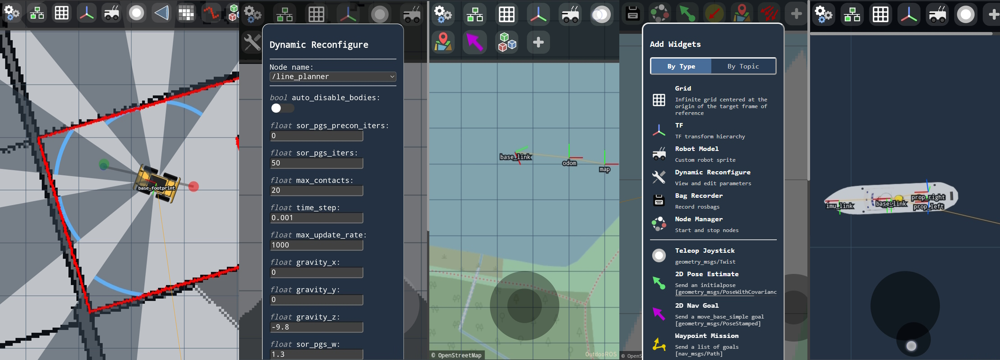

#  Vizanti - Web Visualizer & Mission Planner for ROS

[](https://opensource.org/licenses/BSD-3-Clause)

Vizanti is a web-based visualization and control tool developed for more convenient operation of outdoor robots running the Robot Operating System (ROS). The application attempts to replicate RViz's orthographic 2D view as closely as possible with a smartphone friendly interface. The second goal is to allow planning and executing movement and mission commands, i.e. goals and waypoints, with custom buttons and parameter reconfigure.

 

## Installation

This branch is compatible with [ROS Noetic](https://wiki.ros.org/noetic/Installation) on 20.04 and [ROS One](https://ros.packages.techfak.net/) on 22.04 and 24.04, for ROS 2 [see here](https://github.com/MoffKalast/vizanti/tree/ros2).

As a field tool, Vizanti is designed to operate just as well without internet access, and as such the intended way is to host it on a robot, with rosbridge autoconnecting to the host IP. 

```bash
cd ~/catkin_ws/src
git clone -b ros1 https://github.com/MoffKalast/vizanti.git
cd ..
rosdep install -i --from-path src/vizanti -y
catkin_make
```

### Docker

Alternatively, you can also containerize Vizanti. For that you need to [install Docker](https://docs.docker.com/engine/install/ubuntu/) and build the container:

```bash
git clone -b ros1 https://github.com/MoffKalast/vizanti.git
cd vizanti
docker build -f docker/Dockerfile -t vizanti:1.0 .
```

### WebRTC video streaming (optional)

The image widget can also stream camera topics as H.264 video over WebRTC, which uses far less bandwidth than sending individual images, at the cost of video encoding on the robot's CPU. This requires aiortc and PyAV, which are not installed by rosdep:

```bash
pip3 install aiortc
```

PyAV is installed along with it. On Ubuntu 24.04 you'll need to add `--break-system-packages`. On Python 3.8 (Noetic on 20.04), pip will automatically pick older compatible versions.

## Run
  
```bash
roslaunch vizanti server.launch
```  
Or with Docker:
```bash
docker run -dit --net=host --name vizanti-ros1 vizanti:1.0
```  

The web app can be accessed at `http://<host_ip>:5000`. Client settings are automatically saved in localStorage. The satelite imagery renderer also uses the indexedDB to store tiles for offline use (note that this is IP specific). By default the rosbridge instance also occupies port 5001.

If you're using a mobile device connected to a robot's hotspot that doesn't have internet access, make sure to turn off mobile data. This will prevent Android from sending packets to the wrong gateway.

####  Check [the wiki](https://moffkalast.github.io/vizanti_docs) for usage and configuration instructions, as well as feature and compatibility info.

## Contributing

Please see [Contributing.md](Contributing.md) for more information.
